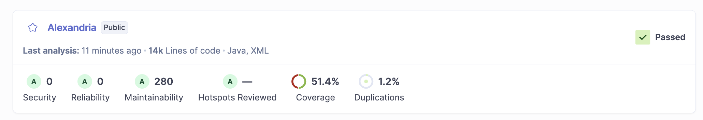

# Sprint 7 Review Report

During Sprint 7, the team focused on testing the functional and non-functional features of the application. The team wrote the Acceptance Test Plan, updated the user stories, ran the unit tests after the code clean-up, and analysed the code with SonarQube.

## Individual Commit Update

- **Kseniia Shlenskaia:** Acceptance Test Plan, user story update, SonarQube analysis and fixes.
- **Veikka Liukkonen:**
- **Luara Moreira Da Silva:**
- **Unna Postila:**

## Product / Sprint Backlog Update

Completed tasks:

- Wrote the Acceptance Test Plan with acceptance criteria, a coverage matrix and functional, usability, performance and reliability test cases.
- Added the localization user stories from Trello to the User Story Map.
- Ran the unit and integration tests after the code clean-up. All 367 tests pass.
- Analysed the code with SonarQube and fixed the reported issues:
  - Bug (Reliability C): the regular expression that splits a text into paragraphs in AnalysisUtils.java could cause a stack overflow on very large texts. It was replaced with an equivalent regular expression.
  - Vulnerability (Security E): the test database password was written in the GitHub Actions workflow. It was moved to an environment variable.
  - After the fixes, all SonarQube grades are A.

SonarQube report after the fixes:

## GitHub Update

Changes added to the repository:

- Acceptance Test Plan.
- Updated User Story Map.
- SonarQube bug and vulnerability fixes.
- Sprint 7 review report.

## Team Member Tasks

| Team Member | Assigned Tasks | Time Spent (hrs) | In-class Tasks |
| --- | --- | ---: | --- |
| Kseniia Shlenskaia | Acceptance Test Plan User story update SonarQube analysis and fixes | | |
| Veikka Liukkonen | | | |
| Luara Moreira Da Silva | | | |
| Unna Postila | | | |

## Sprint Summary

### What Went Well

-

### What Could Be Improved

-
